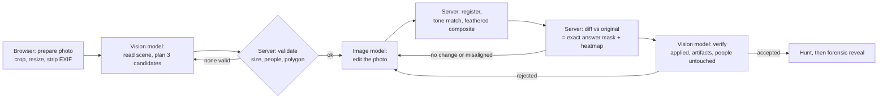

# Fake Dojo

**Train your eye for AI fakes. On your own photos.**

Built during Banana Hacks 2026 (Oct 10 to 11, 2026) by Suhan Nawaz. Theme: "image everything".

| | |
| --- | --- |
| Live URL | https://fake-dojo.vercel.app |
| Demo video | _to be filled in by Suhan after the upload_ |
| Screenshot | _to be added by Suhan as `docs/screenshot.png` once the deck is seeded_ |

> When AI can image everything, seeing is no longer believing. Fake Dojo turns image AI against itself to train the human eye.

## The problem

Anyone can edit any photo in seconds now. Media literacy is still taught with a handful of static examples that people memorize. Companies train their staff with simulated phishing mails, but nobody trains people with simulated image fakes, and certainly not with personal, adaptive ones.

## What it does

An AI agent forges one subtle, realistic edit into a real photo: your own, or one from the built-in deck. You hunt for it. Then a forensic reveal shows exactly which pixels changed, how a careful eye could have caught it, and what forensic tools would have shown. The dojo tracks which kinds of manipulation fool you and makes the next forgery target them.

- **Forge** (live): upload or shoot a photo, watch the agent timeline (redacted so it does not spoil the answer), then hunt with zoom, pan and a loupe. Two guesses, an optional hint.
- **Daily Dojo**: ten cards, about 70% forged and 30% untouched. Call each one Real or Edited, then locate the edit for bonus points. Zero API calls.
- **Classroom**: projector mode. Huge image, a 10 second countdown so the class can vote by raising hands, then a big reveal with the tell. Space reveals, Right arrow moves on, F toggles fullscreen. With "Vote by camera" the laptop camera counts raised hands: left half of the picture votes Real, right half votes Edited, the box lights up while hands are up, and after the countdown the class learns whether its majority was right. Hand detection runs in the browser (MediaPipe Hand Landmarker); video never leaves the device. No accounts, nothing stored.
- **Profile**: belts from White to Black, a radar chart of the six manipulation types, recent rounds.

First real users: Suhan leads the AI club at his high school in Germany (students from grade 8, weekly sessions on using AI wisely and responsibly). Classroom mode is built for exactly that.

## How it works



The client runs the forge as three calls (`/api/forge/plan`, `/render`, `/verify`), so each request stays far below serverless limits and the UI shows real progress with measured durations.

1. **Prepare** (browser): apply EXIF orientation, center-crop to the nearest aspect ratio the image model supports, resize to a 1024 px long edge, re-encode as JPEG. This removes EXIF data including GPS before anything is uploaded.
2. **Plan** (vision model, structured JSON output): scene summary, people boxes, up to 20 objects, three diverse candidate edits with region, polygon, a precise edit instruction, a tell and a non-spoiling hint.
3. **Validate** (server): boxes are clamped; the region must fit the difficulty's area range; it must stay at least 5% of the image width away from every detected person; polygons must not be degenerate. If no candidate survives, the planner is asked once more with the rejection reasons.
4. **Forge** (image model): the full photo plus one instruction, same aspect ratio requested.
5. **Composite** (server, pure TypeScript in `src/lib/cv`): resize to the original size, find the integer shift (up to 8 px, coarse then fine) that best registers the model output to the original in a 24 px ring around the region, match tone per channel from that ring, then blend only the planned region through a dilated, Gaussian-feathered mask.
6. **Measure**: luma difference between original and composite, 3x3 box blur, threshold at 10/255, morphological opening. The result is the answer key. It is exact because we composited the image ourselves. A changed area below 0.1% means the edit was not applied and triggers a retry.
7. **Verify** (vision model): compares original and forgery. Safety flags (a person altered, anything inappropriate) always discard the result. Quality flags trigger a retry with a stricter instruction or the next candidate. At most three image calls per forge. Every rejection is shown openly in the agent log.
8. **Post-process by difficulty**: levels 1 and 2 are saved at JPEG quality 95, so the pasted region still compresses differently and ELA can find it. Level 3 uses quality 90. Levels 4 and 5 add faint global noise and quality 85, which hides most forensic traces. The reveal explains this.

### Adaptive training

- Points: 100 x difficulty for a hit on the first guess, 60 x on the second, minus 30 for the hint and 20 per lab tool. A correct Real or Edited call is worth 50.
- Skill per type is the mean of Beta(1 + hits, 1 + misses). One minus that mean, normalized, is the weight the planner receives.
- Difficulty starts at 2, goes up after two hits in a row and down after a miss.
- Everything lives in `localStorage` under `fakedojo.profile.v1`. The app keeps working when storage is blocked.

## Forensic methods

All three are implemented from scratch on raw pixel arrays (`src/lib/forensics`) and run in a Web Worker, with a main-thread fallback. No image-processing library is used in the browser.

- **ELA (error level analysis)**: re-encode as JPEG quality 0.90, take the per-channel absolute difference, amplify 20x. Areas saved a different number of times compress differently.
- **Noise residual**: luma minus its 3x3 median, then the standard deviation over 8x8 blocks, on a hand-written color ramp. Generated patches are often smoother or noisier than their surroundings.
- **Edges**: Sobel gradient magnitude. Shows seams and unnaturally clean edges.
- **Loupe**: a 3x magnifier that follows the pointer or finger.

Forensics give clues, not proof. The app says so wherever a lens is shown.

## Safety and ethics

A forgery trainer is net positive for the same reason phishing simulations are: people learn to resist a trick by meeting it in a safe place, and here the answer is always shown right after. The guardrails are enforced in code, not only in prompts:

- **People are never edited.** The planner is instructed so, the server rejects any region near a detected person, and the verifier's `people_altered` flag discards a result.
- **Sensitive documents are refused**: IDs, receipts, chat screenshots, news articles, medical and legal documents, and photos that are mostly a person.
- **Nothing is stored.** Images exist in memory for the length of a request. Production logs hold a route name, a status code and timings only.
- **EXIF and GPS are stripped** in the browser before upload.
- **No download of live forgeries.** There is no save or share feature for forged images. The committed deck is made only from Suhan's own harmless scenes.
- **The API is not an open image editor.** The plan route issues a signed ticket that binds the photo to the instructions the server validated. The render and verify routes reject anything else.
- **SynthID**: images produced by the Gemini image model carry an invisible watermark.
- **Cost and abuse limits**: per-IP hourly limit, global daily cap, and a kill switch.

## Tech stack

- Next.js 16 (App Router), React 19, TypeScript (strict), Tailwind CSS 4
- `@google/genai` (Gemini Interactions API), `zod` 4, `sharp`
- Vitest (146 tests), `tsx` for scripts
- No UI kit, no chart library, no state library, no database, no accounts

## Models used

| Role | Model | Notes |
| --- | --- | --- |
| Reading, planning, verifying | `gemini-3.8-flash` | structured JSON output, minimal thinking |
| Image editing | `gemini-nano-banana-2.1` (Nano Banana 2.1) | 1K output, same aspect ratio as the input |

All ids are configurable through environment variables and are read in exactly one place, `src/lib/server/env.ts`.

### Optional: models on BytePlus ModelArk

The edit step can run on Seedream 4.0 (ByteDance, through BytePlus ModelArk) instead of the Gemini image model.

```
IMAGE_PROVIDER=seedream
ARK_API_KEY=...
SEEDREAM_MODEL=seedream-4-0-250828
```

Seedream needs a larger canvas than our 1024 px working size, so the edit is requested at 1.5 times the size and scaled back before registration and compositing. Seedream output carries no SynthID watermark; the other guardrails are unchanged.

Reading, planning and verifying can move to a ModelArk vision model as well. It gets the same prompts and schemas, and its answers pass the same server-side validation.

```
VISION_PROVIDER=ark
ARK_VISION_MODEL=seed-2-0-lite-260428
```

With both switches set, the app runs on the Ark key alone.

## Running cost

One forge is one image output (about 0.034 USD) plus two cheap vision calls. A retry adds one more image output, with a hard limit of three per forge. Daily Dojo, Classroom and the landing page cost nothing: they run from the committed deck.

## Run locally

```
npm install && npm run dev
```

Without an API key the app runs in **mock mode**: a deterministic offline provider replaces Gemini, so the whole pipeline (compositing, measuring, scoring, reveal, lenses) can be tried for free. The UI shows a "Mock mode" label.

For live forging, copy `.env.example` to `.env.local` and set `GEMINI_API_KEY`. The Gemini image model needs a key with billing enabled. With `IMAGE_PROVIDER=seedream` the Gemini key is only used for the vision calls and `ARK_API_KEY` pays for the edits. With `VISION_PROVIDER=ark` on top, no Gemini key is needed.

| Command | What it does |
| --- | --- |
| `npm run dev` / `build` / `start` | Next.js |
| `npm run typecheck`, `npm test`, `npm run lint` | quality gates |
| `npm run smoke -- <photo> [--difficulty 1..5]` | plan, render and verify from Node; writes `tmp/smoke/`; prints timings and estimated cost |
| `npm run seed [-- --limit N] [-- --dry-run]` | builds the deck from `seed/photos/*` |

### Seeding the deck

1. Put 15 to 25 photos into `seed/photos/` (scenes without recognizable faces, readable license plates or anything private).
2. `npm run seed -- --dry-run` shows the plan and the estimated cost.
3. `npm run seed` writes `public/deck/<id>/original.jpg`, `forged.jpg`, `mask.png`, `heat.png` and `public/deck/deck.json`. It is resumable and runs two photos at a time.
4. Commit `public/deck`.

The seed run also writes `dataset/manifest.jsonl` (image, original, mask, type, difficulty): a pixel-exact labeled forgery-localization dataset as a research by-product. The manifest points at the deck files, so no second copy of the images is kept.

For a reproducible demo, `/?demo=1` and `/dojo?seed=demo` use a fixed card order. Add an optional `"demoOrder": ["card-id", ...]` array to `deck.json` to curate it.

### Deploying on Vercel

1. Push this repository to GitHub.
2. In Vercel choose **Add New, Project** and import the repository. The framework preset is detected as Next.js; keep the defaults.
3. Under **Environment Variables** add `GEMINI_API_KEY` and, if you want values other than the defaults, the other variables from `.env.example`.
4. Deploy. Open `/api/health`: it should report `"liveForge": true` and `"mock": false`.
5. To pause live forging at any time, set `LIVE_FORGE_ENABLED=false` and redeploy. The deck modes keep working.

Route handlers run on the Node.js runtime with `maxDuration = 60`.

## Project structure

```
src/app/                 pages: / forge dojo classroom profile how-it-works
src/app/api/             health, forge/plan, forge/render, forge/verify
src/components/          ImageStage, BeforeAfterSlider, AgentTimeline, LensSwitcher, Hunt, Reveal, ...
src/lib/ai/              provider interface, Gemini and mock providers, prompts, schemas, retry, output
src/lib/cv/              polygon, mask, blur, align, tone, composite, diff (pure TypeScript)
src/lib/forensics/       ELA, noise residual, Sobel, color ramp, worker client
src/lib/forge/           the agent loop (plan, render, verify, retries) and shared API types
src/lib/game/            scoring, belts, Beta skill model, difficulty, deck, seeded RNG, tells
src/lib/image/           crop math, browser and Node image preparation
src/lib/server/          env, rate limit, signed tickets, validation, codec, pipeline, errors
src/workers/             forensics worker
scripts/                 smoke.ts, seed-deck.ts
docs/                    BUILD_BRIEF.md, DECISIONS.md, QA.md
```

## Limitations

- Rate limits and ticket use counts live in the memory of one server instance. On a platform with several instances the effective limits are per instance. The kill switch is the hard stop.
- Alignment handles integer shifts of up to 8 px. Scaling or rotation drift of the image model is caught by the retry, not corrected.
- People detection relies on the vision model. The margin, the verifier flag and the composite mask are three layers on top, but none of them is a formal guarantee.
- The forensic lenses are teaching tools. They are not a detector and can be fooled, which the higher difficulty levels demonstrate on purpose.
- The verifier is a model too. If it is unreachable, the forgery is used with the planner's own tell and the log says so.

## What's next

- Teacher dashboards with class-level weak spots, still without student accounts
- C2PA provenance: show and explain content credentials next to the forensic lenses
- A browser extension that turns any image on the web into a training round
- More manipulation types (weather, time of day, reflections, perspective)
- Training a small forgery-localization model on the generated dataset and comparing it against the ELA baseline

## Credits and licenses

- [Next.js](https://nextjs.org) and [React](https://react.dev) (MIT)
- [Tailwind CSS](https://tailwindcss.com) (MIT)
- [Google Gen AI SDK `@google/genai`](https://github.com/googleapis/js-genai) (Apache-2.0)
- [zod](https://zod.dev) (MIT)
- [MediaPipe Tasks Vision](https://github.com/google-ai-edge/mediapipe) and its Hand Landmarker model by Google (Apache-2.0), used for the camera vote in Classroom
- [sharp](https://sharp.pixelplumbing.com) (Apache-2.0), built on libvips (LGPL)
- [Vitest](https://vitest.dev) (MIT), [tsx](https://tsx.is) (MIT), [TypeScript](https://www.typescriptlang.org) (Apache-2.0), [ESLint](https://eslint.org) (MIT)
- [Geist](https://vercel.com/font) Sans and Mono (SIL Open Font License)
- Gemini API by Google: `gemini-3.8-flash` and `gemini-nano-banana-2.1`
- Seedream 4.0 and Seed 2.0 Lite by ByteDance through BytePlus ModelArk
- Photos in the deck: cards named `photo-…` are by Suhan Nawaz. Cards named `web-…` use photos from Wikimedia Commons that their authors released into the public domain (CC0):

| Deck id | Photo | Author | License |
| --- | --- | --- | --- |
| `web-01` | [Fixed bollard bicycle stand.jpg](https://commons.wikimedia.org/wiki/File:Fixed_bollard_bicycle_stand.jpg) | Jeroen Hoek | CC0 |
| `web-02` | [Bike Rack at Bandar Tropicana Aman.jpg](https://commons.wikimedia.org/wiki/File:Bike_Rack_at_Bandar_Tropicana_Aman.jpg) | Wiki Farazi | CC0 |
| `web-03` | [Improved stands bicycle parking.jpg](https://commons.wikimedia.org/wiki/File:Improved_stands_bicycle_parking.jpg) | boototter.eu | CC0 |
| `web-04` | [Three Style Of Bicycle Parking - Park Anička, Košica, SK.jpg](https://commons.wikimedia.org/wiki/File:Three_Style_Of_Bicycle_Parking_-_Park_Ani%C4%8Dka,_Ko%C5%A1ica,_SK.jpg) | Wkmdjay | CC0 |
| `web-05` | [Playground at William Henry Harrison Park.jpg](https://commons.wikimedia.org/wiki/File:Playground_at_William_Henry_Harrison_Park.jpg) | SnugPancake | CC0 |
| `web-06` | [Playground Spring Jeep Soltau.jpg](https://commons.wikimedia.org/wiki/File:Playground_Spring_Jeep_Soltau.jpg) | RogerWiki | CC0 |
| `web-07` | [Harrison Playground 2.jpg](https://commons.wikimedia.org/wiki/File:Harrison_Playground_2.jpg) | Kurt Kaiser | CC0 |
| `web-08` | [Bus stop sign with sky in the backround.jpg](https://commons.wikimedia.org/wiki/File:Bus_stop_sign_with_sky_in_the_backround.jpg) | C.M.B. | CC0 |
| `web-09` | [CARTA bus stop - October 2025 - Sarah Stierch.jpg](https://commons.wikimedia.org/wiki/File:CARTA_bus_stop_-_October_2025_-_Sarah_Stierch.jpg) | Missvain | CC0 |
| `web-10` | [Yangdong Village 05.jpg](https://commons.wikimedia.org/wiki/File:Yangdong_Village_05.jpg) | Bernard Gagnon | CC0 |
| `web-11` | [Valenica Mar Harbour Spain - Image with boats in line up.jpg](https://commons.wikimedia.org/wiki/File:Valenica_Mar_Harbour_Spain_-_Image_with_boats_in_line_up.jpg) | Yannick Sl | CC0 |
| `web-12` | [Some Boats in harbour.jpg](https://commons.wikimedia.org/wiki/File:Some_Boats_in_harbour.jpg) | Maneesh4242 | CC0 |


## AI disclosure

Claude Code wrote most of the code under Suhan's direction. Gemini models run at runtime: a vision model reads, plans and verifies, and an image model performs the edits. All code was written and committed during the hacking window.
